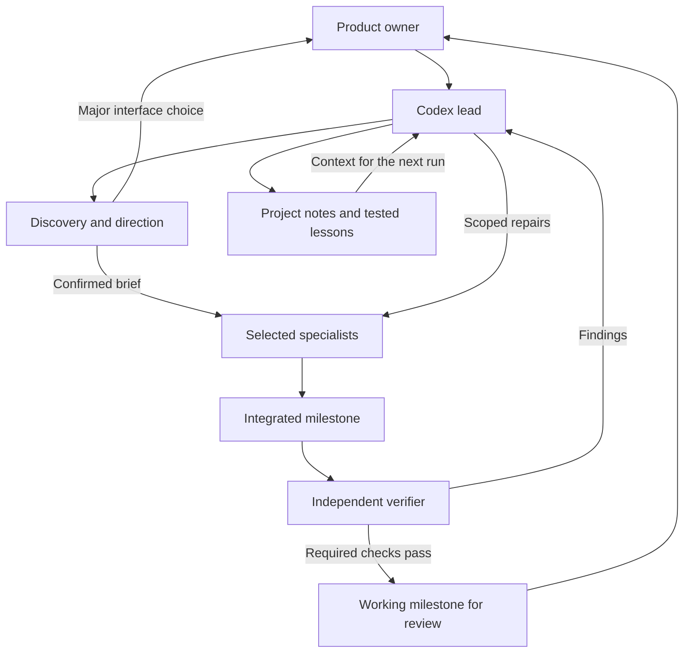

# Spiral

Spiral is a Codex skill for taking a product idea from the first conversation to a working milestone. Its eight agent roles cover product strategy, web and native mobile design, copy, frontend, backend, orchestration, and independent verification.

## Why I built it

I wanted Codex to challenge my product ideas before building, bring in outside perspectives, and give me real alternatives to choose from. Once we agree on a direction, I want the team to work independently and bring me back when there’s a decision to make or something working I can try. I’d rather start with one polished flow and carry the lessons from building it into the next run.

## How it works

1. **Clarify the brief.** For a rough idea, the lead interviews you, challenges consequential assumptions, and brings in relevant research. For a major interface change, it asks you to choose among distinct directions. A specific fix can go directly to reproduction and replay.
2. **Build a working slice.** The lead owns the criteria and interfaces. It assigns scoped work to product, web or native mobile design, copy, frontend, and backend roles as needed. Backend work starts by tracing the existing system and reviewing consequential architectural choices before dependent edits.
3. **Verify and repair.** A separate verifier drives the integrated artifact against the current criteria. Failed checks return to the owner for bounded repair. The evidence script checks that required results belong to the recorded artifact and criteria.
4. **Carry forward what worked.** The lead records demonstrated lessons with the project. A mapped Notion project can hold nested documents for vision, research, decisions, and delivery evidence.



## The agents

The main Codex chat normally leads. It calls the specialists needed for the work, agrees on shared interfaces before parallel implementation, and gives each edit a clear owner.

| Agent | When it joins | What it delivers |
| --- | --- | --- |
| [Product orchestrator](skills/product-orchestrator/agents/product-orchestrator.toml) | A brief spans several disciplines or needs coordinated delivery | The agreed scope, acceptance criteria, task ownership, and working milestones for review |
| [Product strategist](skills/product-orchestrator/agents/product-strategist.toml) | The audience, problem, or scope is still open | The core user journey, consequential tradeoffs, and testable criteria for the smallest complete release |
| [Web designer](skills/product-orchestrator/agents/web-designer.toml) | A website or web app needs a direction, including responsive mobile web | Layout, hierarchy, responsive behavior, and accessible interaction states |
| [Mobile designer](skills/product-orchestrator/agents/mobile-designer.toml) | A native iOS or Android flow needs design | Platform-specific navigation, gestures, safe areas, keyboard behavior, and accessibility states |
| [Product copywriter](skills/product-orchestrator/agents/product-copywriter.toml) | A flow needs labels, instructions, or feedback people can act on | Exact copy for actions, errors, and recovery, with a Humanizer pass that preserves meaning and voice |
| [Frontend engineer](skills/product-orchestrator/agents/frontend-engineer.toml) | Approved design and copy need to work in the client | Accessible interactions, loading and failure states, integration with the agreed API, and relevant tests |
| [Backend engineer](skills/product-orchestrator/agents/backend-engineer.toml) | A change touches APIs, data, or infrastructure | A trace of the existing system, justified architecture decisions, and tested server behavior for validation, authorization, and persistence |
| [Product verifier](skills/product-orchestrator/agents/product-verifier.toml) | A milestone is integrated or a repair is ready to check | An independent verdict for each criterion, tied to the artifact tested, with failures and missing evidence called out |

The configured defaults use GPT-6.2 Astra for the orchestrator and verifier, and GPT-6.1 Terra for the other six roles where available. [Model routing](skills/product-orchestrator/references/model-routing.md) · [Task playbooks](skills/product-orchestrator/references/task-playbooks.md) · [Evidence recipe](skills/product-orchestrator/references/verification-recipe.md)

## Install

With Codex and Python 3.11 or newer, clone the repository and run the installer:

```sh
git clone https://github.com/nicocampanell/Spiral.git
cd Spiral
python3 skills/product-orchestrator/scripts/install.py
```

The installer registers eight Codex roles, installs the `product-orchestrator` skill, and updates its managed section in your Codex `AGENTS.md`. It backs up changed existing files. Start a fresh Codex session to load the roles.

In Codex, invoke `$product-orchestrator` with your brief. A mapped Notion workspace is optional. With no connection, the lead can use local project notes and evidence.

Models and native agent capabilities depend on your Codex host. The [model routing guide](skills/product-orchestrator/references/model-routing.md) explains the default tiers and fallbacks.

## Check the package

```sh
python3 -m unittest discover -s skills/product-orchestrator/tests -v
```

The tests cover installation, preservation of existing guidance, and evidence validation. The [evaluation scenarios](skills/product-orchestrator/evals/) cover routing, review, and role-specific craft.

## Roadmap

The current skill coordinates work during an active Codex session. Future work includes validated run-state transitions, recovery from interruptions, and optional release integrations. A separate evaluation track will compare representative work with and without Spiral.

## Sources

pstack informed task routing, scoped delegation, and the verification recipe. Oh My Claude Code informed the staged delivery and repair loop. The repository includes selected upstream sources with their original MIT notices. [pstack sources](skills/product-orchestrator/references/upstream-pstack/README.md) · [Oh My Claude Code sources](skills/product-orchestrator/references/upstream-omc/README.md)
